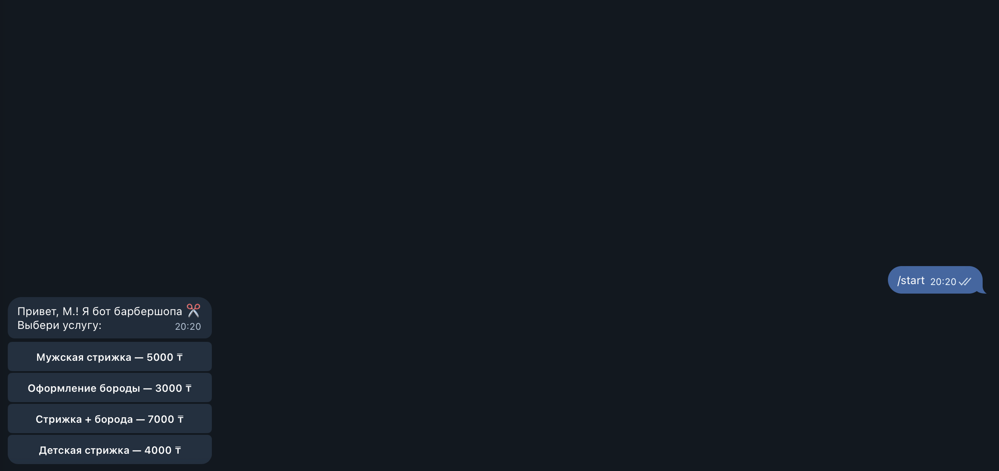
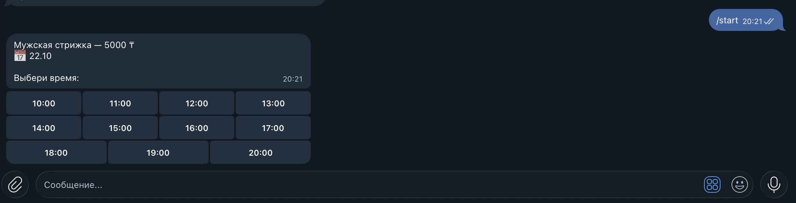
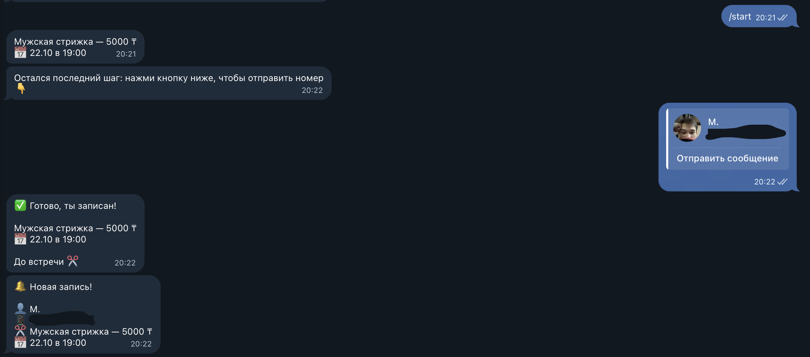

# ✂️ Barber Bot

Telegram-бот для онлайн-записи в барбершоп. Клиент записывается за 30 секунд, не звоня и не переписываясь, а владелец сразу получает уведомление о новой записи.

👉 Бот: [@moraxxvi_barber_bot](https://t.me/moraxxvi_barber_bot) (пока работает в демо-режиме, запуск на сервере 24/7 в планах)

## Что умеет

- Выбор услуги с ценами
- Выбор дня на неделю вперёд и свободного времени
- Занятое и уже прошедшее время скрывается автоматически: двух клиентов на одно время не будет
- Номер телефона в один тап, через кнопку Telegram
- Мгновенное уведомление владельцу: имя, телефон, услуга, дата и время
- Все записи сохраняются в базу данных

## Скриншоты

| Услуга | День | Время | Готово |
|:---:|:---:|:---:|:---:|
|  |  |  |  |

## Технологии

- Python 3.14
- aiogram 3 — работа с Telegram Bot API
- SQLite — база данных записей
- FSM (машина состояний) — пошаговый сценарий записи

## Как запустить

```bash
git clone https://github.com/moraxxvi/barber-bot.git
cd barber-bot
python3 -m venv venv
source venv/bin/activate
pip install -r requirements.txt
```

Создай файл `.env`:

```
BOT_TOKEN=токен_от_BotFather
ADMIN_ID=telegram_id_владельца
```

Запуск:

```bash
python bot.py
```

## Зачем я это сделал

Хотел попробовать что-то новое и сделать первый реальный проект, а не учебное задание. Выбрал запись в барбершоп, потому что многие небольшие бизнесы до сих пор принимают записи в переписке и теряют клиентов. Пока делал, разобрался с базой данных, состояниями бота и Git. Это первый шаг к моей цели: делать продукты, которые решают реальные задачи бизнеса.

## Планы

- [ ] Записи на сегодня и отмена записи для владельца
- [ ] Отмена записи клиентом
- [ ] Напоминание клиенту за 2 часа до визита
- [ ] Выходные дни и перерывы
- [ ] Запуск на сервере 24/7

---

Автор: Мансур · [moraxxvi.github.io](https://moraxxvi.github.io)